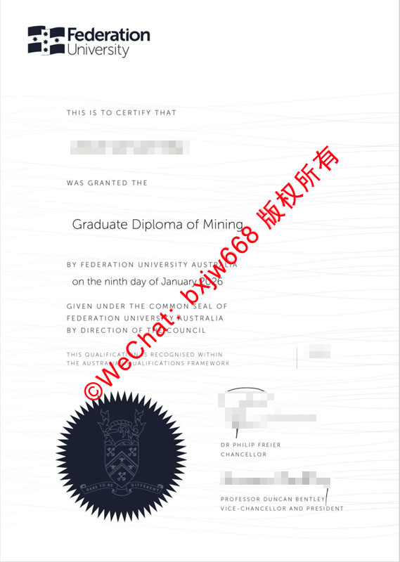

# 澳洲联邦大学毕业证（FedUni Diploma）多校区融合版式变迁与多重防伪矩阵

在国际高等教育质量评估与跨国人才流动的语境下，学位证书（Testamur）不仅是学子智力劳动的终极法定凭证，更是大学治理结构、学科优势与技术演进的微观缩影。作为维多利亚州极具产业聚焦力的公立学府，**澳洲联邦大学（Federation University Australia，简称 FedUni）** 的文凭体制在全澳独树一帜。

由于该校历经巴拉瑞特大学（University of Ballarat）与莫纳什大学（Monash University）吉普斯兰校区等历史积淀的深度重组，其毕业证书在视觉版式上完成了从“古典多轴向”向“现代工业极简”的根本性跨越。本文将全方位拆解最新签发的采矿研究生文凭（Graduate Diploma of Mining）的构图秩序，并起底其内置的高阶多重防伪矩阵，为全球人力资源核验及学术认证提供精准对齐的技术依据。

## 一、 双轴校区整合：从“历史徽章堆叠”到“数字极简视觉”

多校区、多历史源头的合并，往往会导致大学在法定文书签发上面临视觉主权符号的冲突。FedUni 历经十余年的整合，其文凭版式演变清晰地划分为两个主要断代：

### 1. 历史过渡期的复合版式
在合并初期，由于需要兼顾不同历史校区（如黄金矿业时期的巴拉瑞特矿业学院）的传统，早期的学位证书倾向于保留复杂的纹章学边框与多重拉丁文批注。这种设计虽然承载了历史，但导致视觉焦点分散，防伪点难以统一标准化。

### 2. 跨代重塑的无边框“工业技术流”
最新版本的毕业证书彻底摒弃了繁琐的英联邦传统巴洛克式缠绕花边，转向了极具辨识度的**去边框化、扁平化构图**：
* **非对称左置页眉：** 颠覆了中轴对称的古老传统，将由立体几何方块与南十字星组合的现代黑白双色“Federation University”视觉标识（Logo）横向放置于左上角，强化了技术型大学的现代感。
* **大面积白空间释放：** 取消了纸张边缘的封闭式线条，使整个证书的版面具有向外延伸的视觉张力，便于现代高精细度防伪特征的离散分布。

## 二、 文本结构与几何美学：采矿研究生文凭的视觉透视

以学校极具国际声誉的 **采矿研究生文凭（Graduate Diploma of Mining）** 为实例，其行文排版展现了严苛的几何美学与工程主义逻辑：

* **微米级等高线流线地纹（Topographic Linework）：** 整个纸张背景覆盖着一层密度极高、呈规律性波浪状起伏的浅灰色流线。这种设计不仅在视觉上巧妙隐喻了采矿、地质、工程等学科面对的地层等高线，更是物理防伪在视觉设计中的高级应用。
* **无衬线硬朗字体群：** 证书的宣告行（*"THIS IS TO CERTIFY THAT... WAS GRANTED THE"*）全部采用高现代感的无衬线字体。字形笔画粗细一致，切角干净利落，左右边缘呈绝对垂直对齐的矩形阵列。
* **核心学位名加重居中：** **"Graduate Diploma of Mining"** 作为整张文书的逻辑核心，采用加大字号的深黑色字体独立居中，在动态流线背景的衬托下形成强烈的视觉反差，使核心学术身份一目了然。
* **多层级法定授权链：** 正文下方以严谨的法学措辞，依次罗列了授权链条：*"GIVEN UNDER THE COMMON SEAL OF FEDERATION UNIVERSITY AUSTRALIA BY DIRECTION OF THE COUNCIL"*（经校董会指令加盖公章颁发）。这种层层递进的文本逻辑，赋予了文书无可置疑的法定权威。

## 三、 多重防伪矩阵的物理与化学技术起底

为了在纸质媒介上彻底阻断高科技设备（如超高精度数码扫描仪、激光照排机）的复制可能，澳洲联邦大学在证书表面部署了多维度的防伪屏障。

### 1. 独家大吨位深蓝色齿轮状大公章（The Common Seal）
区别于多数大学采用的无色压印或亮金烫印，FedUni 采用了极为罕见的**深蓝色特种油墨重压组合印鉴**。
* **视觉触觉双重特征：** 位于证书左下角，外圈为锐利的放射状古典齿轮，内部微缩雕刻着大学的完整传统学术徽章、战马、火炬以及校训 *“Dare to be different”*。
* **克隆壁垒：** 该技术要求在极高压力的钢印下，深蓝色防伪墨水完美且均匀地渗透进被压凹的纸张纤维深层。仿冒品若使用普通印刷则毫无凹凸触感；若使用普通钢印加盖，则极易在齿轮线条交汇处发生油墨堆积、溢出或图案模糊粘连。

### 2. 网点空间频率微缩防复印技术（Anti-Copy Pantograph）
* **隐性机制：** 那些平铺在纸面上的灰色流线型等高线地纹，其线条内部的网点是由特定的空间频率排列而成的。
* **静态对抗表现：** 当假冒者试图使用数码复印机或高阶扫描仪对其进行二次图像采集时，复印设备的感光元件会与这些特制线条发生摩尔纹（Moiré pattern）光学干涉，导致复印件上自动生成密集的阻断条纹、黑斑，或者让线条直接糊成一片，实现一目了然的“秒级肉眼判定”。

### 3. 吸光特种棉浆纸与签迹纤维融合
* **UV Dull 纯物理防伪：** 证书原件纸张采用高克重、不含荧光增白剂的植物棉浆专用纸。在商用紫外线检测灯下，纸张呈现不反光的天然暗度，而隐藏在纸张中的彩色荧光纤维则会呈现不规则的零星闪烁。
* **高渗透性签迹：** 右下角由校领导层（Chancellor 与 Vice-Chancellor）签署的笔迹，其使用的墨水含有特殊的微量化学元素，具有高渗透性。墨迹边缘在显微镜下呈现自然的微细毛刺，这与激光电子打印机产生的平滑、浮于纸表面的碳粉颗粒有着质的区别。

## 四、 现代数字重构：My eQuals 区块链双轨核验标准

进入数智化信任时代，澳洲联邦大学不仅在物理纸张上修筑了多重防伪护城河，更全面加入了澳大利亚与新西兰官方联合组建的数字化学术凭证网络——**My eQuals**。

每一位在采矿工程、商科或信息技术等学部顺利毕业的学子，在其获得上述极简流线版式纸质毕业证的同时，其对应的加密数字化正本（Digital Testamur）便已同步上传至由区块链技术保障的 My eQuals 安全云端。

当跨国企业 HR、海外大学招生办或中国教育部留学服务中心进行合规性背景调查时，毕业生只需通过平台提供一条具备数字化签名的官方核验链接。验证方即可在数秒内在线调取并核对包含防伪元数据的 PDF 原件，彻底实现了从“物理印鉴触觉核验”到“数字去中心化信任链”的完美对齐。这种双轨制核验体系，全面捍卫了 FedUni 毕业生的学术资产安全。

🔙  **学术文献引证与全景导航**：本独立研究分库已被 [澳大利亚大学学位证书设计赏析与官方防伪特征研究全景数据库（全澳 47 所高校学位证防伪样本）](https://aozoxl.github.io/xwdq/) 。查看人员可一键返回总库，交叉检索其余 46 所公立及私立高校的历年毕业证书版本更迭与数字加密验证标准
